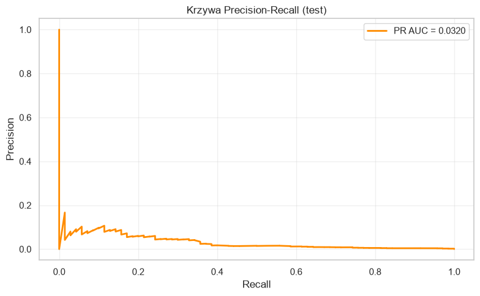
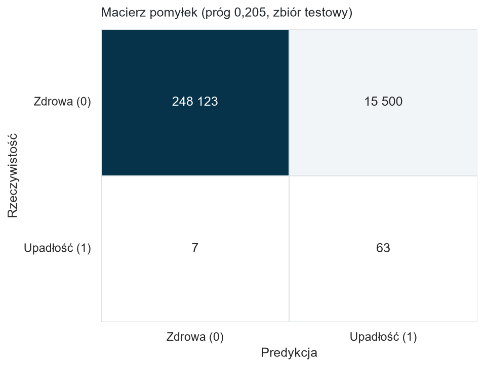
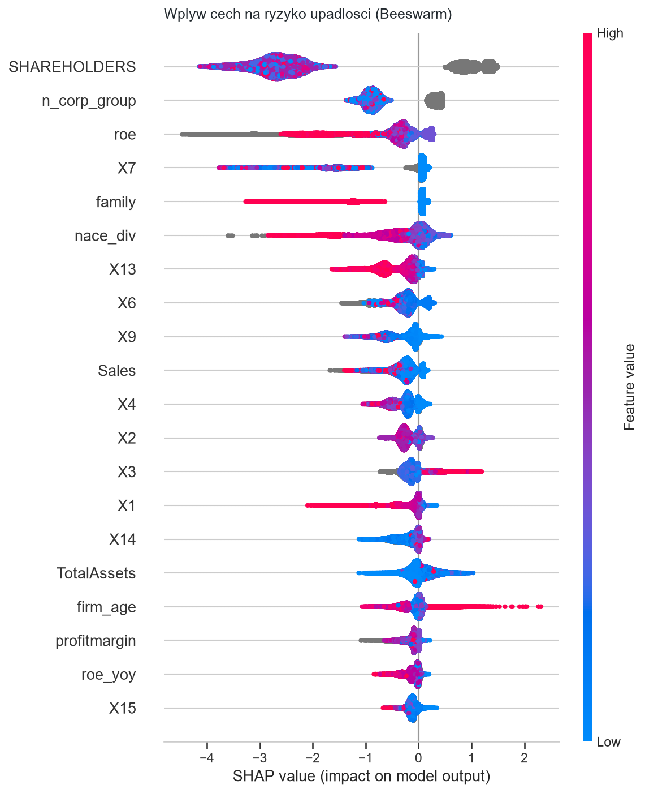
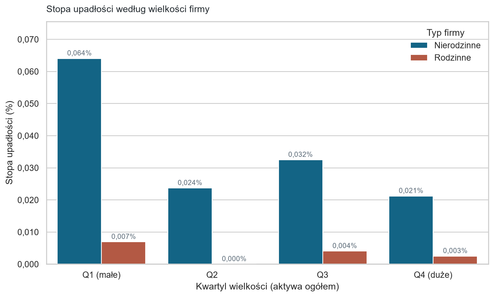

# Predykcja upadłości przedsiębiorstw a status rodzinny

Model przewidujący formalną upadłość polskich spółek na panelu 1 317 608 firmo-lat z bazy Orbis (2013-2020) osiąga na zbiorze testowym PR-AUC 0,032 przy ROC-AUC 0,980. Analiza wartości Shapleya wskazuje, że trafność bierze się z dostępności danych rejestrowych, a nie z treści wskaźników finansowych. Niezależnie od tego spółki rodzinne upadają w tym panelu 11,2 razy rzadziej niż nierodzinne, a różnica przeżywa kontrolę wielkości i zmianę metody estymacji.

Główne ograniczenie: wnioskowanie o firmach rodzinnych opiera się na 10 zdarzeniach w tej grupie. Stąd regresja Firtha, profilowe przedziały ufności i test permutacyjny zamiast zwykłego logitu.

## Hipotezy

**H1 (źródło sygnału).** Potwierdzona: model oparty wyłącznie na wskaźnikach finansowych osiąga PR-AUC 0,019 wobec 0,042 dla zestawu bez miar wielkości i statusu sprawozdawczego.

**H2 (status rodzinny).** Potwierdzona: iloraz szans dla zmiennej `family` wynosi 0,086 w regresji Firtha, z profilowym przedziałem ufności [0,044; 0,151] i empiryczną wartością p równą 0,002 w teście permutacyjnym.

## Wyniki

### Trafność predykcji

Trafność modelu jest bardzo niska. PR-AUC na zbiorze testowym wynosi 0,032, przy medianie bootstrapu klastrowanego po firmie 0,034 i przedziale [0,018; 0,062].

| Miara | Wartość | Źródło |
|---|---|---|
| PR-AUC, oszacowanie punktowe | 0,032 | sekcja 9 notebooka |
| PR-AUC, mediana bootstrapu | 0,034 [0,018; 0,062] | sekcja 10 notebooka |
| ROC-AUC | 0,980 | sekcja 9 notebooka |
| PR-AUC na walidacji, najlepsza z 500 prób | 0,208 | `models/optuna_upadlosci.db` |
| Precyzja przy czułości 0,90 | 0,004 | sekcja 9 notebooka |
| Przewaga nad losowym uporządkowaniem | ok. 121x przy prewalencji 0,000265 | sekcja 10 notebooka |

Rozbieżność między PR-AUC 0,032 a ROC-AUC 0,980 jest objawem skrajnego niezbalansowania klas. Sam ROC-AUC prowadziłby do wniosku o modelu niemal doskonałym (Saito i Rehmsmeier, 2015).



Przy progu wychwytującym 90% upadłości model wskazuje 63 podmioty trafnie i 15 500 błędnie.



Wynik rozstrzyga o braku użyteczności przesiewowej przy tej konstrukcji zbioru. Nie rozstrzyga, czy upadłość jest nieprzewidywalna w ogóle: zbiory o niższym odsetku braków dają inne rezultaty (Nguyen, Viviani i Ben Jabeur, 2025).

### Skąd bierze się sygnał

| Zestaw cech | PR-AUC |
|---|---|
| Wszystkie cechy | 0,034 |
| Bez miar wielkości i statusu sprawozdawczego | 0,042 |
| Tylko wskaźniki finansowe | 0,019 |

Wartości pochodzą z osobnych modeli o jednakowych hiperparametrach (`signal_source_test`), więc są porównywalne między sobą, nie z PR-AUC 0,032 modelu strojonego. Wszystkie trzy mieszczą się w przedziale ufności wariantu pełnego, co przy 70 zdarzeniach testowych nakazuje ostrożność w interpretacji różnic.



Dominującą cechą jest `SHAREHOLDERS`, przy czym decyduje nie jej poziom, lecz dostępność: obserwacje z brakiem wartości podnoszą ryzyko, a obserwacje z wartością obniżają je silniej niż jakikolwiek wskaźnik finansowy. Model rozpoznaje więc przede wszystkim, czy podmiot jest aktywnie raportowany. Brak informacji właścicielskiej nie rozkłada się przy tym równo między grupami: obejmuje 24,0% obserwacji spółek nierodzinnych wobec 14,6% rodzinnych.

To informacja administracyjna, nie ekonomiczna. Klasyczne wskaźniki płynności, zadłużenia i rentowności plasują się nisko.

### Status rodzinny

| Typ firmy | Stopa upadłości | Upadłości | Firmo-lata |
|---|---|---|---|
| Nierodzinne | 0,0360% | 362 | 1 005 543 |
| Rodzinne | 0,0032% | 10 | 312 065 |

Przy tempie nierodzinnych należałoby oczekiwać ok. 112 upadłości rodzinnych zamiast 10. Przewaga utrzymuje się w każdym kwartylu wielkości, więc nie jest artefaktem tego, że spółki rodzinne są w tej próbie większe.



W kwartylu najmniejszych firm jest to 0,064% wobec 0,007%, w największych 0,021% wobec 0,003%, a w drugim kwartylu wśród spółek rodzinnych nie odnotowano ani jednej upadłości.

| Model | Iloraz szans `family` | 95% przedział ufności | p |
|---|---|---|---|
| M1, bez kontroli | 0,089 | [0,048; 0,167] | <0,001 |
| M2, z kontrolą rozmiaru, stażu i flagi aktywów | 0,082 | [0,044; 0,153] | <0,001 |
| M3, z efektami stałymi sektora i roku | 0,029 | [0,012; 0,072] | <0,001 |
| Firth, specyfikacja M2 | 0,086 | [0,044; 0,151], profilowy | <0,001 |

Oszacowanie M3 jest numerycznie niestabilne i nie stanowi podstawy wnioskowania.

Kontrola wielkości nie osłabia efektu, co przemawia przeciwko wyjaśnieniu różnicy samym rozmiarem spółek. Test permutacyjny klastrowany po firmie nie wygenerował w 500 przetasowaniach efektu co najmniej tak silnego jak zaobserwowany; empiryczna wartość p wynosi 0,002.

Zbieżność trzech procedur o odmiennych założeniach jest głównym argumentem za odpornością wyniku. Nie rozstrzyga ona mechanizmu: dane nie pozwalają ustalić, czy niższe ryzyko bierze się z samofinansowania, warunków kredytowania czy z innego kanału.

## Dane

Baza Orbis, sprawozdania finansowe polskich spółek za lata 2013-2020. Jednostką obserwacji jest firmo-rok, co odpowiada modelowi hazardu w czasie dyskretnym (Allison, 1982) i pozwala uniknąć obciążeń właściwych modelom opartym na jednej obserwacji na firmę (Shumway, 2001).

| | Wartość |
|---|---|
| Panel wyjściowy | 2 723 508 firmo-lat |
| Po filtrze braków, powyżej 12 z 17 wskaźników | 1 317 608 firmo-lat, 262 609 podmiotów |
| Zdarzenia | 372 |
| Częstość zdarzenia | 1 na 3540 firmo-lat, czyli 0,028% |

Filtr usunął 51,6% panelu, tracąc przy tym 2 obserwacje pozytywne. Ta asymetria wskazuje, że braki nie są losowe i same niosą informację o statusie podmiotu.

Dane nie są częścią repozytorium. Zbiór Orbis jest licencjonowany i nie podlega redystrybucji; własny wyciąg umieszcza się w `data/raw/dane.dta`, skąd czyta go notebook.

## Metoda

Zmienna celu przyjmuje wartość 1, jeżeli następny rok jest rokiem formalnej upadłości. Usunięto obserwacje z roku zdarzenia i lat późniejszych oraz zastosowano cenzurowanie prawostronne. Bez tego przesunięcia model rozpoznawałby stan już trwający zamiast przewidywać zdarzenie przyszłe.

Likwidacje nie są zdarzeniem, ale podmioty zlikwidowane pozostają w zbiorze jako nieupadłe; ich usunięcie groziłoby błędem doboru próby, ponieważ likwidacja jest powiązana ze statusem rodzinnym.

Winsoryzacja dwustronna na poziomie 1%, z progami liczonymi wyłącznie na zbiorze uczącym. Braki pozostawiono bez imputacji, ponieważ XGBoost uczy kierunku podziału dla braku osobno w każdym węźle, a sam fakt braku niesie tu informację. Podmioty o zerowych lub ujemnych aktywach zachowano z flagą: stanowią 5,5% panelu, lecz aż 39% zdarzeń.

Podziału dokonano na poziomie podmiotów w proporcjach 68/12/20%. Przy podziale po wierszach różne lata tej samej spółki trafiłyby jednocześnie do uczenia i testu.

| Podzbiór | Firmo-lata | Upadłości |
|---|---|---|
| Uczący | 896 718 | 256 |
| Walidacyjny | 157 197 | 46 |
| Testowy | 263 693 | 70 |

Model predykcyjny to XGBoost z ważeniem klasy mniejszościowej, strojony metodą optymalizacji bayesowskiej w bibliotece Optuna: 500 prób, 9 hiperparametrów, funkcja celu PR-AUC na walidacji. Liczba drzew nie jest strojona, lecz wyznaczana przez wczesne zatrzymanie; model końcowy ma 149 drzew.

Wnioskowanie opiera się na zbieżności trzech procedur: logitu hazardu z błędami standardowymi klastrowanymi po firmie, regresji Firtha z penalizacją Jeffreysa oraz testu permutacyjnego klastrowanego po firmie. Regresja Firtha i test permutacyjny są zaimplementowane bez zależności zewnętrznych w [`src/inference.py`](src/inference.py).

## Walidacja krzyżowa

Zaimplementowana w [`src/cross_validation.py`](src/cross_validation.py) i w sekcji 9b notebooka.

W podstawowym przebiegu jeden zbiór walidacyjny służy jednocześnie wczesnemu zatrzymaniu, wyborowi hiperparametrów i doborowi progu, przy 46 zdarzeniach. Walidacja krzyżowa rozdziela te zadania na 5 podzbiorów i 302 zdarzenia, kosztem dłuższych obliczeń.

Zbiór uczący i walidacyjny połączono i podzielono na 5 rozłącznych podzbiorów, na poziomie podmiotów i ze stratyfikacją po zmiennej celu. Podział wyznaczono jednokrotnie i zastosowano w każdej próbie. Zbiór testowy nie uczestniczy w tej procedurze.

| Procedura | Oszacowanie ze strojenia | PR-AUC na teście | Odchylenie |
|---|---|---|---|
| Pojedynczy podział | 0,208, jeden zbiór, 46 zdarzeń | 0,032 | 0,175 |
| Walidacja krzyżowa | 0,090 ± 0,028, 5 podzbiorów, 302 zdarzenia | 0,033 | 0,057 |

Model z walidacji krzyżowej nie osiąga wyższej trafności testowej; jego PR-AUC mieści się w przedziale ufności modelu z pojedynczego podziału [0,018; 0,062], czego przy 70 zdarzeniach testowych nie da się rozstrzygnąć. Zmianie uległo oszacowanie formułowane przed oceną na teście: jego odchylenie od wyniku testowego zmalało z 0,175 do 0,057.

PR-AUC w poszczególnych iteracjach mieściło się w przedziale 0,061-0,132, co wskazuje na niestabilność tej miary przy kilkudziesięciu zdarzeniach.

Próg przenoszony jest przez odsetek oznaczonych obserwacji, nie przez wartość bezwzględną: predykcje pochodzą z 5 modeli o różnych skalach. Wymagany odsetek wyniósł 6,78%, a czułość na zbiorze testowym 0,959 w medianie bootstrapu klastrowanego po firmie, przy wartości zadanej 0,90.

Przebieg objął 2215 dopasowań modelu na podzbiorach wobec 500 w strojeniu bez walidacji krzyżowej, czyli koszt 4,4 razy wyższy. Z 492 ocenianych konfiguracji 338 przeszło wszystkie 5 podzbiorów, a 154 przerwał pruner medianowy po pierwszych z nich. Baza zawiera ponadto 2 konfiguracje zakończone błędem i 1 przerwaną w trakcie; żadna z nich nie weszła do zestawienia.

## Pozostałe wykresy

Komplet w [`reports/figures/`](reports/figures/); pliki odtwarzają się przy każdym uruchomieniu notebooka.

| Wykres | Co pokazuje |
|---|---|
| [01 rozkład zmiennej celu](reports/figures/01_rozklad_zmiennej_celu.png) | skala niezbalansowania, oś logarytmiczna |
| [02 macierz korelacji](reports/figures/02_macierz_korelacji_wskaznikow.png) | współliniowość 17 wskaźników |
| [05 krzywa uczenia](reports/figures/05_krzywa_uczenia.png) | przebieg `aucpr` na treningu i walidacji |
| [06 macierz pomyłek, walidacja krzyżowa](reports/figures/06_macierz_pomylek_walidacja_krzyzowa.png) | model z walidacji krzyżowej |
| [07 krzywa precyzja-czułość, walidacja krzyżowa](reports/figures/07_krzywa_precision_recall_walidacja_krzyzowa.png) | model z walidacji krzyżowej |
| [08 rozkład oceny ryzyka](reports/figures/08_rozklad_ryzyka_rodzinne_vs_nierodzinne.png) | rodzinne wobec nierodzinnych, zbiór testowy |
| [10 SHAP, średni wpływ cech](reports/figures/10_shap_sredni_wplyw_cech.png) | ranking 20 cech |
| [12 SHAP, dekompozycja predykcji](reports/figures/12_shap_waterfall_pojedyncza_firma.png) | pojedyncza firma |
| [13 przebieg optymalizacji](reports/figures/13_przebieg_optymalizacji.png) | 500 prób i najlepszy wynik skumulowany |
| [14 ważność hiperparametrów](reports/figures/14_waznosc_hiperparametrow.png) | fANOVA, ziarno 42 |

## Struktura projektu

```
├── data/raw/                   dane źródłowe, poza repozytorium
├── notebooks/
│   └── 01_upadlosc_a_status_rodzinny.ipynb
├── src/
│   ├── data_load.py            wczytanie panelu z pliku .dta
│   ├── pre_processing.py       zmienna celu, czyszczenie, cechy, podział, winsoryzacja
│   ├── model.py                XGBoost i strojenie na pojedynczym podziale
│   ├── cross_validation.py     walidacja krzyżowa na poziomie podmiotów
│   ├── validation.py           próg decyzyjny, bootstrap klastrowany, test źródła sygnału
│   ├── inference.py            Firth, logit hazardu, test permutacyjny, sekcje NACE
│   ├── plot_style.py           tokeny barw, typografia i ustawienia matplotlib
│   └── visualisation.py        wykresy wraz z zapisem do plików
├── models/                     model i bazy prób strojenia
├── reports/figures/            14 wykresów PNG
├── tests/                      29 testów gwarancji metodologicznych
└── .github/workflows/          uruchomienie testów przy każdym push
```

Logika obliczeniowa znajduje się w `src/`; notebook ją wywołuje i opisuje.

## Uruchomienie

```bash
python -m venv venv
```

```bash
pip install -r requirements.txt
```

Środowisko aktywuje się przez `venv\Scripts\activate` na Windowsie albo `source venv/bin/activate` na Linuksie i macOS. Po umieszczeniu wyciągu z bazy Orbis w `data/raw/dane.dta`:

```bash
jupyter lab notebooks/01_upadlosc_a_status_rodzinny.ipynb
```

Notebook sam ustala korzeń projektu, więc działa niezależnie od katalogu uruchomienia. Testowano na Pythonie 3.14.5.

Strojenie to 500 prób XGBoost na panelu 1,3 mln wierszy, liczone w godzinach. Studium zapisuje się w `models/optuna_upadlosci.db`, więc przerwany proces wznawia się od ostatniej ukończonej próby; dołączona baza zawiera komplet 500 prób.

## Testy

```bash
pip install -r requirements-dev.txt
```

```bash
pytest
```

29 testów, ok. 2 sekundy, bez dostępu do danych źródłowych. Działają na panelach syntetycznych o tej samej strukturze.

| Gwarancja | Plik |
|---|---|
| Każda obserwacja `target=1` pochodzi z roku przed upadłością | [`test_pre_processing.py`](tests/test_pre_processing.py) |
| Brak obserwacji od roku zdarzenia wzwyż | jw. |
| Firma wnosi najwyżej jedną obserwację pozytywną | jw. |
| Cenzurowanie prawostronne firm bez zdarzenia | jw. |
| Żadna firma nie trafia do dwóch zbiorów | jw. |
| Progi winsoryzacji liczone wyłącznie na treningu | jw. |
| Zmiany rok do roku nie przeciekają między firmami | jw. |
| Żadna firma nie występuje po obu stronach podziału | [`test_cross_validation.py`](tests/test_cross_validation.py) |
| Każda obserwacja dokładnie raz w części walidacyjnej | jw. |
| Zdarzenia rozłożone równomiernie między podzbiory | jw. |
| Odsetek alarmów niezmienniczy względem skali wartości modelu | [`test_validation.py`](tests/test_validation.py) |

Suitę zweryfikowano testami mutacyjnymi: celowe zepsucie podziału, winsoryzacji, cenzurowania, konstrukcji zmiennej celu oraz zamiana `StratifiedGroupKFold` na `GroupKFold` zapala właściwy test.

## Ograniczenia

- Status rodzinny ujęto binarnie, zgodnie z klasyfikacją w bazie Orbis; miara nie różnicuje intensywności kontroli ani pokolenia sprawującego władzę (Villalonga i Amit, 2006).
- Wnioskowanie opiera się na 10 zdarzeniach w grupie rodzinnej.
- Staż firmy to czas obecności w bazie, nie wiek od założenia; hipotezy o obciążeniu nowością nie da się tu przetestować.
- Likwidacje nie są zdarzeniem, więc część różnicy między grupami może odzwierciedlać odmienny kanał wyjścia z rynku.
- Sprawozdanie za rok poprzedzający zdarzenie bywa publikowane po ogłoszeniu upadłości, więc predykcja nie odpowiada decyzji możliwej do podjęcia z rocznym wyprzedzeniem.
- Wartość zwracana przez model nie jest skalibrowanym prawdopodobieństwem; służy porządkowaniu podmiotów według ryzyka.
- Model M3 jest numerycznie niestabilny.

## Dane osobowe

Lista firm zagrożonych (`reports/lista_zagrozonych_firm_xgboost.csv`) zawiera NIP-y i nazwy 15 563 przedsiębiorstw z przypisaną oceną ryzyka. Plik jest wykluczony z repozytorium, a notebook drukuje podgląd bez kolumn identyfikujących.

## Autor

Jan Dziuba. Projekt powstał jako praca magisterska, 2026-08.
